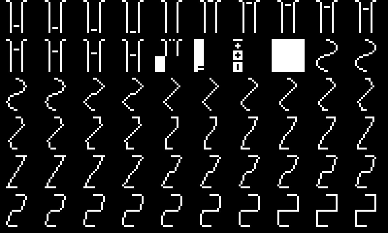

# How the stock UI draws its morphing glyphs: stored frames

DN2 1.11, a static read, 2026-10-20. The owner asked a question: does the firmware draw a knob's picture from the value, or pick it from stored frames? Grades: [D] read from the image, [I] inferred.

## The answer

The glyphs are stored frames. Each glyph is a list of small 1-bit pictures in the firmware, one per step, and the value picks one [D]. No maths draws the shape at run time.

The picture above is a dump of 60 frames of 17 x 17 pixels, read straight from the flash. It starts at `0x402f10d0`, which is a guess at the start of WaveTone's list (below). The frames are stored rotated by 90 degrees. In it, a sine turns into a triangle, a saw and then a square. The first rows look like the frames of another control (pulse widths).

## The chain

1. **The draw.** WaveTone's OSC page draws its two icons with `0x40016cee` (`docs/waverider-m7-pages.md`). That routine calls `0x40115b5e(list, value, 0x7800, 0)` and blits the bitmap it returns with `0x401157fc`.
2. **The picker.** `0x40115b5e` takes a list of 28-byte `Bitmap` objects: begin at `+0`, end at `+4`. It works out the frame count with a multiply by the inverse of 7. Then it computes the frame index as value x (count - 1) / range, rounded, and returns `begin + 28 x index` [D]. Flags in its fourth argument change the rounding and the end cases. Two wrappers call it with fixed ranges: `0x40115ca8` (0 or 0x7f00) and `0x40115ccc` (0x8000).
3. **How often it is used.** The picker has 12 direct callers. The wrappers have 50 and 15. So 77 call sites pick a frame by value [D]. They are probably most of the type-5 glyphs in `docs/modulation-display.md` (WAV, PD, FOLD, HARM and the others) [I]. Each one is not checked.
4. **The frame lists.** The lists are objects in RAM near `0x446474dc..0x44647570`, built and freed by static initialisers (near `0x40169c88`). WaveTone's is at `0x4464752c`, with a second one at `0x44647150` for its other table.
5. **The frames.** `0x40151f0e` fills the lists at start-up. For each frame it builds a 17 x 17 `Bitmap` over a pointer into flash (`0x402f1d90`, `0x402f1dd4` and so on, 0x44 bytes apart: 17 rows of 4 bytes). It then adds 60 of them to `0x4464752c` (`0x401530f0`) [D]. So the pixels themselves are in the firmware, drawn by hand.

## What this means for us

- A mod that wants a stock-looking glyph for a new control can do the same. It stores frames and picks one with `0x40115b5e`.
- Waverider's page draws its wave from the table instead (`csrc/waverider/page.c`), because its tables are not known at build time.
- The site's mod glyphs (`site/js/mods/glyphs.js`) are single still frames in the same 1-bit style.

## Not done yet

- **Which list belongs to which control:** read the list addresses each of the 77 call sites passes.
- **The exact start and count of each list in flash:** follow every push in `0x40151f0e`.
- **Whether any glyph is drawn by maths:** none was found among these call sites, but the search covered only the picker's callers.
